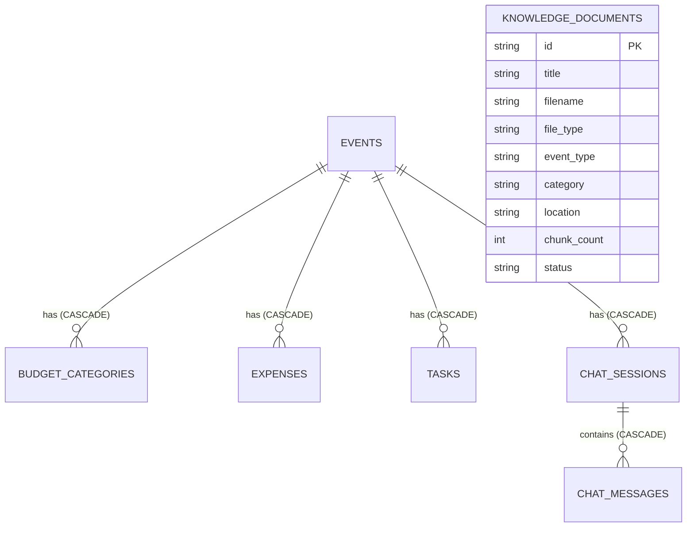

# EventWise AI — Comprehensive Project Documentation

> **Document Scope**: This technical documentation is generated directly from the implemented source code, configuration files, database models, API schemas, and test suite of **EventWise AI — Smart Event Planning Assistant** (`v1.0.0`).

---

## Table of Contents

1. [Application Overview and Purpose](#1-application-overview-and-purpose)
2. [Core Features and Functionalities](#2-core-features-and-functionalities)
3. [Complete Technology Stack and Dependencies](#3-complete-technology-stack-and-dependencies)
4. [Project Folder and File Structure](#4-project-folder-and-file-structure)
5. [Frontend Architecture, Pages, Components, and Routing](#5-frontend-architecture-pages-components-and-routing)
6. [Backend Architecture and Business Logic](#6-backend-architecture-and-business-logic)
7. [Database Schema, Models, and Relationships](#7-database-schema-models-and-relationships)
8. [API Endpoints and Integrations](#8-api-endpoints-and-integrations)
9. [Authentication, Authorization, and User Roles](#9-authentication-authorization-and-user-roles)
10. [Complete User Workflows and Application Flow](#10-complete-user-workflows-and-application-flow)
11. [Environment Variables and Configuration](#11-environment-variables-and-configuration)
12. [Third-Party Services and Integrations](#12-third-party-services-and-integrations)
13. [Installation, Setup, and Local Development Instructions](#13-installation-setup-and-local-development-instructions)
14. [Build, Testing, and Deployment Instructions](#14-build-testing-and-deployment-instructions)
15. [Error Handling, Validation, and Security Mechanisms](#15-error-handling-validation-and-security-mechanisms)
16. [Known Limitations, Incomplete Features, and TODOs](#16-known-limitations-incomplete-features-and-todos)

---

## 1. Application Overview and Purpose

**EventWise AI** is a full-stack, **local-first Generative AI application** designed to help users plan **weddings**, **birthdays**, and **community events**.

### Primary Objectives
- **100% Local AI Execution**: Operates without external cloud AI inference APIs (no OpenAI, Gemini, Claude, or Anthropic APIs). Language generation runs via a local **Ollama** service, text embeddings are generated locally via **Sentence Transformers**, and vector embeddings are persisted locally in **ChromaDB**.
- **Deterministic Financial & Schedule Authority**: While the local LLM generates narrative summaries, theme concepts, and qualitative suggestions, **Python is the sole authority** for monetary arithmetic (stored and validated in **integer Indian Rupees / INR**) and relative milestone deadline calculations.
- **Grounded Retrieval-Augmented Generation (RAG)**: Recommendations are grounded in documents indexed in the local knowledge base (`.pdf`, `.txt`, `.csv`, `.json`, and structured entries). Every citation returned to the UI maps strictly to a verified chunk ID retrieved from ChromaDB.
- **Honest Cost Attribution**: The system never fabricates live vendor availability, ratings, or booking confirmations. All sample prices and category allocations are explicitly labeled as **illustrative estimates**.
- **Modern Mario-Inspired SaaS Interface**: Provides a responsive web dashboard built with Next.js App Router and Tailwind CSS using original CSS/SVG retro platformer motifs (question blocks, star milestones, coins, pipe badges, and brick dividers) without using copyrighted Nintendo assets.

---

## 2. Core Features and Functionalities

### Implemented Features (Verified in Codebase)

1. **Command Center Dashboard (`/`)**
   - Displays live aggregated metrics from SQLite (`total_events`, `upcoming_events_count`, `completed_tasks / total_tasks`, `overall_completion_percentage`, `remaining_budget_across_events`, and `indexed_documents_count`).
   - Renders upcoming events as game-level cards (`WORLD 1-1`, `WORLD 2-1`, etc.) with progress bars.
   - Displays active task quests with one-click status updates (`pending`, `in_progress`, `completed`).
   - Compiles a cross-entity **Recent Activity Log** from persisted events, expenses, knowledge documents, and chat messages.
   - Displays live Ollama reachability and active model status in the top navigation bar.

2. **AI + RAG Event Planner (`/planner`)**
   - Validated creation form for event name, event type (`birthday`, `wedding`, `community`), location, total budget in integer INR, guest count, event date, preferred theme, dietary requirements, and additional preferences.
   - Includes one-click demo preset buttons (`₹25,000 Birthday (50 Guests)`, `₹5,00,000 Wedding (200 Guests)`, `₹75,000 Community (150 Guests)`).
   - Automatically initializes deterministic budget categories, generates relative timeline milestones, retrieves semantic passages from ChromaDB, calls local Ollama (or deterministic fallback if Ollama is offline), and persists the complete plan in SQLite.

3. **Event Plan Details & Preference Editor (`/events/[id]`)**
   - Displays event metadata, generation mode (`ollama`, `deterministic_fallback`, or `seeded_illustrative_sample`), theme recommendations, AI planning suggestions, budget breakdown, interactive task checklist, and expandable RAG source citations.
   - Includes an inline **Preference Editor** (`PATCH /api/events/{id}`) that recalculates budgets/timelines when budget, date, or guest scale changes, and supports regenerating the AI plan (`POST /api/events/{id}/generate-plan`).
   - Embeds a contextual **AI Chat** panel bound to the current event.

4. **Authoritative Python Budget Planner (`/budget`)**
   - Computes and displays `total_budget`, `planned_spending`, `actual_spending`, `emergency_reserve`, `remaining_planned_budget`, `remaining_actual_budget`, and `overrun_amount`.
   - Implements the exact illustrative ₹25,000 birthday template (`Venue: ₹5,000`, `Food and beverages: ₹8,000`, `Decoration: ₹3,000`, `Cake: ₹2,000`, `Entertainment: ₹2,000`, `Miscellaneous: ₹2,000`, `Emergency reserve: ₹3,000`) plus tailored templates for `wedding` and `community` events.
   - Renders interactive **Recharts** visualizations: a Donut `PieChart` of category shares and a `BarChart` comparing Planned vs. Actual spending per category.
   - Provides an editable category allocation form with a strict **user-approval guard** (`user_approved_total_change`) whenever the total event budget is modified.
   - Includes an **Expense Ledger** to record and delete actual expenditures (`POST /api/events/{id}/expenses`, `DELETE /api/events/{id}/expenses/{expense_id}`).
   - Generates deterministic **Cost Reduction Suggestions** with a one-click preview into the allocation editor.

5. **Chronological Quest Timeline & Checklist (`/events/[id]/timeline`)**
   - Generates relative deadlines backward from `event_date` (e.g., `-21`, `-14`, `-7`, `-3`, `-1`, and `0` days for birthdays; `-60` to `0` days for weddings; `-30` to `0` days for community events).
   - Automatically inserts a large-scale crowd/catering milestone (`Ten days before (Large Scale)`) when `guest_count >= 150`.
   - Clamps past or short-notice milestone dates to `today` (`is_clamped = True`) and surfaces a `schedule_notice` banner so impossible past deadlines are never scheduled silently.
   - Supports status filtering (`all`, `pending`, `in_progress`, `completed`), status toggling, task deletion, and custom milestone task creation.

6. **Persistent AI Planning Chatbot (`/chat`)**
   - Supports multi-turn event-aware or general conversations persisted in SQLite (`chat_sessions` and `chat_messages`).
   - Provides quick prompt chips for common queries (e.g., *"Reduce my event budget by ₹5,000."*, *"Suggest three alternative birthday themes."*, *"What tasks remain before my event?"*, *"How can I reduce decoration costs?"*, *"Suggest a wedding plan for 200 guests."*, *"Adapt my plan for a vegetarian menu."*).
   - **Non-Destructive Proposal Workflow**: When a user asks to reduce the budget or change dietary preferences, `ChatService` computes a deterministic `ProposedBudgetChange` preview without mutating SQLite. The user must click **"Approve & Apply Proposal to Event"** in the UI to persist the change.

7. **Knowledge Base Manager (`/knowledge-base`)**
   - Supports uploading `.pdf`, `.txt`, `.csv`, and `.json` files (`POST /api/knowledge/upload`) up to `MAX_UPLOAD_SIZE_MB` (default `10 MB`).
   - Supports creating and editing structured knowledge entries (`POST /api/knowledge/entries`, `PUT /api/knowledge/entries/{id}`).
   - Displays all indexed documents with status badges (`indexed`, `failed`), chunk counts, metadata, re-indexing (`POST /api/knowledge/documents/{id}/reindex`), and deletion (`DELETE /api/knowledge/documents/{id}`).
   - Provides a **Semantic Search & Retrieval Preview** tool (`POST /api/knowledge/search`) with `event_type`, `location`, and `top_k` controls, returning passage excerpts, cosine similarity scores, raw vector distances, and fallback notices.

8. **First-Run Sample Seeding**
   - On startup, if SQLite has 0 knowledge documents, `seed_initial_data` automatically ingests 9 curated reference documents from `backend/data/sample_data/` and creates 1 clearly labeled illustrative sample event (`Star Kingdom 21st Birthday Bash (Illustrative Sample)`).

---

## 3. Complete Technology Stack and Dependencies

### Frontend Stack (`frontend/package.json`)

| Package | Version Spec | Role in Application |
| :--- | :--- | :--- |
| `next` | `14.2.15` | React framework using App Router (`app/`) |
| `react` / `react-dom` | `^18.3.1` | Core UI rendering and client components |
| `typescript` | `^5.6.3` | Strict static type checking (`strict: true`, no `any`) |
| `tailwindcss` | `^3.4.14` | Utility-first styling and custom `mario.*` color palette |
| `recharts` | `^2.13.0` | Category allocation `PieChart` and Planned vs. Actual `BarChart` |
| `react-hook-form` | `^7.53.1` | Form state management in `/planner` |
| `zod` / `@hookform/resolvers` | `^3.23.8` / `^3.9.0` | Client-side schema validation (`lib/validation.ts`) |
| `lucide-react` | `^0.454.0` | Accessible UI icons across navigation, cards, and forms |
| `clsx` | `^2.1.1` | Conditional class name utility |
| `postcss` / `autoprefixer` | `^8.4.47` / `^10.4.20` | CSS processing pipeline |
| `eslint` / `eslint-config-next` | `^8.57.1` / `14.2.15` | Frontend linting |

### Backend Stack (`backend/requirements.txt`)

| Package | Version Spec | Role in Application |
| :--- | :--- | :--- |
| `fastapi` | `>=0.115.0` | REST API framework and OpenAPI schema generation |
| `uvicorn[standard]` | `>=0.30.0` | ASGI server for FastAPI |
| `pydantic` | `>=2.9.0` | Request/response validation and structured LLM output parsing |
| `pydantic-settings` | `>=2.5.0` | Environment variable configuration (`app/config.py`) |
| `SQLAlchemy` | `>=2.0.30` | ORM and relational persistence with SQLite |
| `httpx` | `>=0.27.0` | Local HTTP client for communicating with Ollama (`localhost:11434`) |
| `sentence-transformers` | `>=3.0.0` | Local text embedding generation (`all-MiniLM-L6-v2`) |
| `chromadb` | `>=0.5.0` | Persistent local vector database (`backend/chroma_db`) |
| `pypdf` | `>=4.2.0` | PDF text extraction during knowledge base ingestion |
| `python-multipart` | `>=0.0.9` | Multipart form-data parsing for file uploads |
| `python-dotenv` | `>=1.0.1` | `.env` file loading |
| `pytest` | `>=8.0.0` | Automated unit, API, integration, and RAG evaluation testing |

---

## 4. Project Folder and File Structure

```text
gen ai - event planning/
├── CLAUDE.md                                     # Root development & architectural rules
├── README.md                                     # Quickstart guide & command reference
├── PROJECT_DOCUMENTATION.md                      # Comprehensive technical documentation (this file)
├── .env.example                                  # Root environment variable template
├── .gitignore                                    # Git ignore rules for DBs, vector stores, .env, build artifacts
│
├── instructions/                                 # Original project specification files
│   └── New folder/
│       ├── Root.md
│       ├── backend.md
│       ├── frontend.md
│       ├── rag.md
│       ├── testing.md
│       └── Project folder structure.txt
│
├── frontend/                                     # Next.js 14 App Router application
│   ├── CLAUDE.md                                 # Frontend design & accessibility rules
│   ├── package.json                              # Node dependencies & scripts
│   ├── tsconfig.json                             # Strict TypeScript configuration
│   ├── next.config.mjs                           # Next.js configuration
│   ├── postcss.config.mjs                        # PostCSS plugins
│   ├── tailwind.config.ts                        # Tailwind theme (mario colors & retro shadows)
│   ├── app/
│   │   ├── globals.css                           # Global styles, :user-invalid rules, brick/pipe motifs
│   │   ├── layout.tsx                            # Root HTML shell, Navbar, and Footer
│   │   ├── page.tsx                              # Route: / (Dashboard)
│   │   ├── planner/page.tsx                      # Route: /planner (Event Planner)
│   │   ├── budget/page.tsx                       # Route: /budget (Budget Planner)
│   │   ├── chat/page.tsx                         # Route: /chat (AI Planning Chatbot)
│   │   ├── knowledge-base/page.tsx               # Route: /knowledge-base (Knowledge Base Manager)
│   │   └── events/[id]/
│   │       ├── page.tsx                          # Route: /events/[id] (Event Plan Details)
│   │       └── timeline/page.tsx                 # Route: /events/[id]/timeline (Quest Timeline)
│   ├── components/
│   │   ├── layout/Navbar.tsx                     # Responsive top bar + live Ollama status indicator
│   │   ├── ui/MarioMotifs.tsx                    # Original SVG icons (Coin, Star, QuestionBlock, CloudSkyBanner)
│   │   ├── dashboard/DashboardClient.tsx         # Interactive Dashboard view
│   │   ├── planner/PlannerClient.tsx             # Event creation form & generated plan preview
│   │   ├── budget/BudgetClient.tsx               # Recharts graphs, allocation editor, expense ledger
│   │   ├── timeline/TimelineClient.tsx           # Chronological milestone view & custom task creator
│   │   ├── checklist/TaskQuestList.tsx           # Reusable accessible task status list
│   │   ├── chat/ChatClient.tsx                   # Chat UI + Proposal Approval card
│   │   └── knowledge/
│   │       ├── KnowledgeClient.tsx               # File upload, structured entry CRUD, semantic search
│   │       └── SourceCitationsList.tsx           # Expandable verified RAG source citations widget
│   ├── lib/
│   │   ├── api.ts                                # Centralized strongly-typed fetch client
│   │   ├── formatting.ts                         # INR currency, date, and badge formatters
│   │   └── validation.ts                         # Zod schemas for forms
│   └── types/
│       ├── event.ts                              # Event, Dashboard, and LLM health TypeScript interfaces
│       ├── budget.ts                             # Budget and Expense TypeScript interfaces
│       ├── task.ts                               # Task and Timeline TypeScript interfaces
│       ├── chat.ts                               # Chat and ProposedBudgetChange TypeScript interfaces
│       └── knowledge.ts                          # KnowledgeDocument and SourceCitation interfaces
│
└── backend/                                      # Python FastAPI & Custom RAG application
    ├── CLAUDE.md                                 # Backend architecture & business logic rules
    ├── requirements.txt                          # Python dependencies
    ├── .env.example                              # Backend environment variable template
    ├── pytest.ini                                # Pytest configuration & integration marker definition
    ├── app/
    │   ├── __init__.py
    │   ├── main.py                               # FastAPI app, lifespan seeding, CORS, global error handler
    │   ├── config.py                             # Pydantic BaseSettings configuration
    │   ├── database/
    │   │   ├── __init__.py
    │   │   ├── models.py                         # 7 SQLAlchemy ORM table definitions
    │   │   ├── session.py                        # Engine, SQLite foreign_keys pragma, SessionLocal, get_db
    │   │   └── repository.py                     # Data access repositories for all entities
    │   ├── schemas/
    │   │   ├── __init__.py
    │   │   ├── event.py                          # Event & Dashboard Pydantic schemas
    │   │   ├── budget.py                         # Budget & Expense Pydantic schemas
    │   │   ├── task.py                           # Task & Timeline Pydantic schemas
    │   │   ├── chat.py                           # Chat & ProposedBudgetChange Pydantic schemas
    │   │   └── knowledge.py                      # Knowledge & SourceCitation Pydantic schemas
    │   ├── services/
    │   │   ├── __init__.py
    │   │   ├── budget_service.py                 # Authoritative integer-INR budget & expense service
    │   │   ├── timeline_service.py               # Relative milestone & date-clamping service
    │   │   ├── event_service.py                  # Event lifecycle & dashboard aggregation service
    │   │   ├── planner_service.py                # Orchestrates RAG retrieval + LLM + budget/timeline
    │   │   ├── chat_service.py                   # Contextual RAG chat + non-destructive proposal engine
    │   │   └── seed_service.py                   # First-run sample knowledge & sample event seeder
    │   ├── rag/
    │   │   ├── CLAUDE.md                         # RAG pipeline design & grounding rules
    │   │   ├── __init__.py
    │   │   ├── extraction.py                     # File validation & PDF/TXT/CSV/JSON text extraction
    │   │   ├── chunking.py                       # Overlapping section-aware chunker & deterministic IDs
    │   │   ├── embeddings.py                     # SentenceTransformerEmbedder & DeterministicLocalMockEmbedder
    │   │   ├── retrieval.py                      # ChromaRetrievalService with progressive filter fallback
    │   │   ├── prompts.py                        # Prompt template loader & untrusted passage formatter
    │   │   ├── generation.py                     # OllamaGenerationService, citation verifier & fallback
    │   │   └── ingestion.py                      # KnowledgeIngestionService (upload, entry, reindex, delete)
    │   ├── prompts/
    │   │   ├── planner_prompt.txt                # Event plan generation system prompt
    │   │   ├── rag_prompt.txt                    # Untrusted document grounding header
    │   │   └── chat_prompt.txt                   # Contextual follow-up chat prompt
    │   └── routes/
    │       ├── __init__.py
    │       ├── events.py                         # /api/dashboard and /api/events routes
    │       ├── planner.py                        # /api/events/{id}/generate-plan route
    │       ├── budget.py                         # /api/events/{id}/budget and /expenses routes
    │       ├── timeline.py                       # /api/events/{id}/tasks and /api/tasks/{id} routes
    │       ├── chatbot.py                        # /api/chat and /api/chat/sessions routes
    │       └── knowledge.py                      # /api/knowledge/* routes
    ├── data/
    │   ├── documents/                            # Local storage directory for uploaded files (gitignored)
    │   └── sample_data/                          # 9 curated initial knowledge base files (.txt, .json, .csv)
    └── tests/
        ├── CLAUDE.md                             # Testing rules & offline requirements
        ├── conftest.py                           # Temporary SQLite/ChromaDB fixtures & offline AI mocks
        ├── test_budget.py                        # Budget arithmetic, overrun, and approval guard tests
        ├── test_timeline.py                      # Milestone dates, clamping, and scale tests
        ├── test_ingestion.py                     # PDF/TXT/CSV/JSON extraction, chunking, idempotency tests
        ├── test_retrieval.py                     # Empty retrieval, location fallback, citation filter tests
        ├── test_planner.py                       # Full API lifecycle & offline Ollama fallback tests
        ├── test_integration_local.py             # Live SentenceTransformer, ChromaDB & Ollama tests
        └── evaluation/
            ├── eval_dataset.json                 # Fixed 5-case RAG evaluation dataset
            └── test_rag_evaluation.py            # Automated RAG retrieval & constraint evaluation test
```

---

## 5. Frontend Architecture, Pages, Components, and Routing

### Routing Table (Next.js App Router)

| Route Path | App Router File | Primary Client Component | Purpose |
| :--- | :--- | :--- | :--- |
| `/` | `frontend/app/page.tsx` | `DashboardClient.tsx` | Command Center Dashboard with metrics, event levels, active quests, and recent activity. |
| `/planner` | `frontend/app/planner/page.tsx` | `PlannerClient.tsx` | Event creation form with Zod validation, quick presets, and instant RAG plan preview. |
| `/events/[id]` | `frontend/app/events/[id]/page.tsx` | `EventDetailPage` (inline client) | Complete event plan view, inline preference editor, plan regeneration, and embedded AI chat. |
| `/events/[id]/timeline` | `frontend/app/events/[id]/timeline/page.tsx` | `TimelineClient.tsx` | Chronological quest timeline, status filter, progress bar, and custom task form. |
| `/budget` | `frontend/app/budget/page.tsx` | `BudgetClient.tsx` (in `<Suspense>`) | Integer-INR budget manager, Recharts graphs, category editor, overrun alerts, and expense ledger. |
| `/chat` | `frontend/app/chat/page.tsx` | `ChatClient.tsx` | Standalone persistent AI chatbot with event selector, prompt chips, and proposal approval cards. |
| `/knowledge-base` | `frontend/app/knowledge-base/page.tsx` | `KnowledgeClient.tsx` | File upload (`.pdf`, `.txt`, `.csv`, `.json`), structured entry CRUD, re-indexing, deletion, and semantic search preview. |

### Design System & Accessibility (`frontend/app/globals.css` & `tailwind.config.ts`)
- **Color Palette**:
  - `mario.sky`: `#8EDBFA`
  - `mario.red`: `#E8483F`
  - `mario.green`: `#279B52`
  - `mario.gold`: `#FFC928`
  - `mario.white`: `#FFFFFF`
  - `mario.navy`: `#20304A` (primary high-contrast text and borders)
  - `mario.bg`: `#F4FAFF` (soft page background)
  - `mario.muted`: `#64748B`
- **Custom Visual Motifs (`components/ui/MarioMotifs.tsx`)**:
  - `CoinIcon`: Original SVG gold coin for budget metrics.
  - `StarMilestoneIcon`: Original SVG star for timeline milestones and badges.
  - `QuestionBlockBadge`: Gold bordered `?` badge for feature headers.
  - `CloudSkyBanner`: Gradient sky banner with original SVG clouds for page headers.
  - `BrickDivider`: CSS-gradient brick divider separating major sections.
- **Accessibility & Modern Web Patterns**:
  - Task status controls in `TaskQuestList.tsx` combine icons (`Circle`, `Clock`, `CheckCircle2`), explicit text labels (`Pending`, `In Progress`, `Completed`), and `aria-pressed` states so status never relies on color alone.
  - Form inputs use `:user-invalid` and `:user-valid` so error borders appear only after user interaction.
  - Native controls use `accent-color: #279B52` with a `@supports not (accent-color: ...)` fallback.
  - `@media (prefers-reduced-motion: reduce)` disables animations for users who prefer reduced motion.

---

## 6. Backend Architecture and Business Logic

The backend follows a layered service architecture under `backend/app/`:
1. **HTTP Layer (`app/routes/`)**: Thin FastAPI routers handling query/path/body parsing and HTTP status codes.
2. **Validation Layer (`app/schemas/`)**: Strict Pydantic v2 models enforcing field constraints, allowed literals, and ISO date formats.
3. **Business Logic Layer (`app/services/`)**:
   - **`BudgetService` (`services/budget_service.py`)**:
     - Enforces integer INR budgets (`total_budget >= 1000`).
     - Implements deterministic allocation ratios for `birthday`, `wedding`, and `community` events, adjusting any rounding remainder on the final category so the sum of `planned_amount` always equals `total_budget` to the exact rupee.
     - Protects `Emergency reserve` categories and generates warnings if `planned_spending > total_budget`, `actual_spending > total_budget`, any category's `actual_spent > planned_amount`, or `emergency_reserve < 5%` of total budget.
     - Enforces the **Budget Approval Guard**: throws `BudgetValidationError` (`HTTP 400`) if a request attempts to change `total_budget` without `user_approved_total_change=True` (or `user_approved_budget_change=True`).
   - **`TimelineService` (`services/timeline_service.py`)**:
     - Generates event-type-specific milestone templates (`BIRTHDAY_MILESTONES`, `WEDDING_MILESTONES`, `COMMUNITY_MILESTONES`).
     - Adds a dedicated crowd-coordination milestone (`10 days before`) when `guest_count >= 150`.
     - Clamps any milestone date that falls before `reference_date` (`today`) to `today`, sets `is_clamped = True`, and populates `schedule_notice` explaining why the timeline was compressed.
     - Preserves `completed` and `in_progress` task statuses when regenerating timelines (`preserve_completed=True`).
   - **`PlannerService` (`services/planner_service.py`)**:
     - Combines `BudgetService`, `TimelineService`, `ChromaRetrievalService`, and `OllamaGenerationService` to generate or refresh an event's complete plan.
   - **`ChatService` (`services/chat_service.py`)**:
     - Builds a deterministic context snapshot of the selected event's budget, categories, and remaining tasks.
     - Detects budget-reduction intents (e.g., *"Reduce my event budget by ₹5,000"*) or dietary update requests (e.g., *"Adapt my plan for a vegetarian menu"*) and constructs a `ProposedBudgetChange` object without mutating the database.
4. **Custom RAG Layer (`app/rag/`)**:
   - **Extraction (`rag/extraction.py`)**: Validates file extension (`.pdf`, `.txt`, `.csv`, `.json`), MIME type, non-empty size, maximum upload bytes (`MAX_UPLOAD_SIZE_MB`), and rejects path traversal (`..`). Extracts structured text from PDFs (`pypdf.PdfReader`), UTF-8/Latin-1 TXT, CSV rows with column headers, and flattened JSON hierarchies.
   - **Chunking (`rag/chunking.py`)**: Splits normalized text into overlapping chunks (`RAG_CHUNK_SIZE=700`, `RAG_CHUNK_OVERLAP=100` defaults) while preserving Markdown section headings (`[Section Heading]`). Generates deterministic document IDs (`doc_{sha256_16}`) and chunk IDs (`{doc_id}_chunk_{index:04d}_{sha256_10}`).
   - **Embeddings (`rag/embeddings.py`)**: Wraps `SentenceTransformer(settings.EMBEDDING_MODEL)` with normalized embeddings (`normalize_embeddings=True`).
   - **Retrieval (`rag/retrieval.py`)**: Queries ChromaDB using cosine space (`hnsw:space = cosine`) and verifies that the collection's stored `embedding_model` metadata matches the active model (`EmbeddingModelMismatchError`). Executes a 3-stage progressive filter fallback:
     1. `event_type IN [target, 'general'] AND category == target`
     2. `event_type IN [target, 'general']`
     3. Unfiltered semantic search across all indexed documents
     Applies a distance boost (`-0.08`) when document location matches the user's location and sets `fallback_applied = True` with an explicit `fallback_reason` when location-specific or strict category matches are absent.
   - **Grounded Generation (`rag/generation.py`)**: Calls `POST {OLLAMA_BASE_URL}/api/generate` with `format="json"` and `stream=False`, strips `<think>...</think>` tags or Markdown fences if present, validates the response with Pydantic (`GeneratedPlanPayload` / `GeneratedChatPayload`), and filters `cited_chunk_ids` against the actual retrieved chunk IDs (`filter_verified_citations`). If Ollama is unreachable or times out, seamlessly synthesizes a deterministic grounded response using the retrieved chunks (`generation_mode="deterministic_fallback"`).

---

## 7. Database Schema, Models, and Relationships

The application uses **SQLite** (`backend/eventwise.db`) with **SQLAlchemy 2.0** (`backend/app/database/models.py`). Foreign key enforcement (`PRAGMA foreign_keys=ON`) is enabled on every SQLite connection in `backend/app/database/session.py`.

### Entity-Relationship Diagram



### Table Definitions

#### 1. `events` (`EventModel`)
- `id` (`Integer`, PK, autoincrement)
- `name` (`String(200)`, not null)
- `event_type` (`String(50)`, indexed, not null: `wedding` | `birthday` | `community`)
- `location` (`String(200)`, not null)
- `total_budget` (`Integer`, not null — integer INR)
- `guest_count` (`Integer`, not null)
- `event_date` (`String(20)`, not null — `YYYY-MM-DD`)
- `preferred_theme` (`String(200)`, default `""`)
- `dietary_requirements` (`String(300)`, default `""`)
- `additional_preferences` (`Text`, default `""`)
- `summary` (`Text`, default `""`)
- `theme_recommendations` (`JSON`, not null, default `[]`)
- `ai_suggestions` (`JSON`, not null, default `[]`)
- `citations` (`JSON`, not null, default `[]`)
- `missing_evidence_note` (`Text`, default `""`)
- `generation_mode` (`String(50)`, not null, default `"pending"`)
- `created_at` / `updated_at` (`DateTime(timezone=True)`, not null)

#### 2. `budget_categories` (`BudgetCategoryModel`)
- `id` (`Integer`, PK, autoincrement)
- `event_id` (`Integer`, FK -> `events.id` `ON DELETE CASCADE`, indexed, not null)
- `name` (`String(120)`, not null)
- `planned_amount` (`Integer`, not null — integer INR)
- `is_emergency_reserve` (`Boolean`, not null, default `False`)
- `notes` (`String(500)`, default `""`)
- `created_at` / `updated_at` (`DateTime(timezone=True)`, not null)

#### 3. `expenses` (`ExpenseModel`)
- `id` (`Integer`, PK, autoincrement)
- `event_id` (`Integer`, FK -> `events.id` `ON DELETE CASCADE`, indexed, not null)
- `category_name` (`String(120)`, not null)
- `title` (`String(200)`, not null)
- `amount` (`Integer`, not null — integer INR)
- `incurred_date` (`String(20)`, not null — `YYYY-MM-DD`)
- `notes` (`String(500)`, default `""`)
- `created_at` (`DateTime(timezone=True)`, not null)

#### 4. `tasks` (`TaskModel`)
- `id` (`Integer`, PK, autoincrement)
- `event_id` (`Integer`, FK -> `events.id` `ON DELETE CASCADE`, indexed, not null)
- `title` (`String(250)`, not null)
- `description` (`Text`, default `""`)
- `milestone_label` (`String(120)`, not null)
- `due_date` (`String(20)`, not null — `YYYY-MM-DD`)
- `status` (`String(30)`, not null, default `"pending"` — `pending` | `in_progress` | `completed`)
- `priority` (`String(30)`, not null, default `"medium"` — `low` | `medium` | `high`)
- `category` (`String(100)`, not null, default `"General"`)
- `is_clamped` (`Boolean`, not null, default `False`)
- `created_at` / `updated_at` (`DateTime(timezone=True)`, not null)

#### 5. `chat_sessions` (`ChatSessionModel`)
- `id` (`Integer`, PK, autoincrement)
- `event_id` (`Integer`, FK -> `events.id` `ON DELETE CASCADE`, nullable, indexed)
- `title` (`String(200)`, not null, default `"Event Planning Session"`)
- `created_at` / `updated_at` (`DateTime(timezone=True)`, not null)

#### 6. `chat_messages` (`ChatMessageModel`)
- `id` (`Integer`, PK, autoincrement)
- `session_id` (`Integer`, FK -> `chat_sessions.id` `ON DELETE CASCADE`, indexed, not null)
- `event_id` (`Integer`, nullable, indexed)
- `role` (`String(30)`, not null — `user` | `assistant`)
- `content` (`Text`, not null)
- `citations` (`JSON`, not null, default `[]`)
- `proposed_changes` (`JSON`, nullable, default `None`)
- `created_at` (`DateTime(timezone=True)`, not null)

#### 7. `knowledge_documents` (`KnowledgeDocumentModel`)
- `id` (`String(64)`, PK — deterministic hash ID `doc_{sha256_16}`)
- `title` (`String(250)`, not null)
- `filename` (`String(250)`, not null)
- `file_type` (`String(30)`, not null — `pdf` | `txt` | `csv` | `json` | `entry`)
- `file_path` (`String(500)`, nullable)
- `raw_content` (`Text`, nullable — normalized extracted text used for re-indexing and editing)
- `event_type` (`String(50)`, not null, default `"general"`)
- `category` (`String(100)`, not null, default `"general"`)
- `location` (`String(150)`, not null, default `"general"`)
- `source_label` (`String(250)`, not null)
- `is_illustrative` (`Boolean`, not null, default `True`)
- `status` (`String(30)`, not null, default `"indexed"` — `indexed` | `processing` | `failed`)
- `chunk_count` (`Integer`, not null, default `0`)
- `error_message` (`Text`, nullable)
- `created_at` / `updated_at` (`DateTime(timezone=True)`, not null)

---

## 8. API Endpoints and Integrations

All endpoints are served by FastAPI (`backend/app/main.py`) and documented interactively via OpenAPI at `/docs`.

### Health & System Status

| Method | Path | Response Model / Payload | Status Codes | Description |
| :--- | :--- | :--- | :--- | :--- |
| `GET` | `/api/health` | `dict` (`status`, `app`, `version`, `local_only`, `embedding_model`, `ollama_model`, `monetary_representation`) | `200` | Application health and active local model metadata. |
| `GET` | `/api/health/llm` | `LlmHealthStatus` (`status`, `ollama_reachable`, `configured_model`, `configured_model_available`, `available_models`) | `200` | Probes `{OLLAMA_BASE_URL}/api/tags` to check local Ollama availability. |

### Dashboard & Events (`backend/app/routes/events.py`, `planner.py`)

| Method | Path | Request Body / Query | Response Model | Status Codes | Description |
| :--- | :--- | :--- | :--- | :--- | :--- |
| `GET` | `/api/dashboard` | None | `DashboardResponse` | `200` | Aggregated metrics, upcoming event cards, active quests, and recent activity. |
| `GET` | `/api/events` | Query: `skip=0`, `limit=50` | `list[EventSummaryCard]` | `200` | Paginated list of event summary cards. |
| `POST` | `/api/events` | Body: `EventCreate` | `EventDetailResponse` | `201`, `400`, `422` | Creates event, initializes budget & timeline, and runs RAG + LLM plan generation. |
| `GET` | `/api/events/{event_id}` | Path: `event_id` | `EventDetailResponse` | `200`, `404` | Returns full event plan, budget summary, tasks, and citations. |
| `PATCH` | `/api/events/{event_id}` | Body: `EventUpdate` | `EventDetailResponse` | `200`, `400`, `404`, `422` | Updates event preferences; requires `user_approved_budget_change=True` if `total_budget` changes. |
| `DELETE` | `/api/events/{event_id}` | Path: `event_id` | `{"status": "deleted", "message": ...}` | `200`, `404` | Deletes event and cascades to categories, expenses, tasks, and chat sessions. |
| `POST` | `/api/events/{event_id}/generate-plan` | Query: `reset_budget=False`, `reset_timeline=False` | `EventDetailResponse` | `200`, `404` | Re-runs RAG retrieval and Ollama plan generation for the event. |

### Budget & Expenses (`backend/app/routes/budget.py`)

| Method | Path | Request Body | Response Model | Status Codes | Description |
| :--- | :--- | :--- | :--- | :--- | :--- |
| `GET` | `/api/events/{event_id}/budget` | None | `BudgetSummaryResponse` | `200`, `404` | Returns deterministic budget summary, warnings, expenses, and cost-saving tips. |
| `PUT` | `/api/events/{event_id}/budget` | Body: `BudgetUpdateRequest` | `BudgetSummaryResponse` | `200`, `400`, `404`, `422` | Replaces category allocations; enforces `user_approved_total_change` if `total_budget` differs. |
| `POST` | `/api/events/{event_id}/expenses` | Body: `ExpenseCreate` | `BudgetSummaryResponse` | `201`, `400`, `404`, `422` | Records an actual expense in integer INR and recalculates balances. |
| `DELETE` | `/api/events/{event_id}/expenses/{expense_id}` | Path: `event_id`, `expense_id` | `BudgetSummaryResponse` | `200`, `404` | Deletes a recorded expense and recalculates balances. |

### Timeline & Tasks (`backend/app/routes/timeline.py`)

| Method | Path | Request Body | Response Model | Status Codes | Description |
| :--- | :--- | :--- | :--- | :--- | :--- |
| `GET` | `/api/events/{event_id}/tasks` | None | `TimelineSummaryResponse` | `200`, `404` | Returns chronological tasks, completion %, and schedule compression notices. |
| `POST` | `/api/events/{event_id}/tasks` | Body: `TaskCreate` | `TaskResponse` | `201`, `404`, `422` | Adds a custom milestone task to the event. |
| `PATCH` | `/api/tasks/{task_id}` | Body: `TaskUpdate` | `TaskResponse` | `200`, `404`, `422` | Updates task status (`pending`, `in_progress`, `completed`), priority, or due date. |
| `DELETE` | `/api/tasks/{task_id}` | Path: `task_id` | `{"status": "deleted", ...}` | `200`, `404` | Deletes a task. |

### AI Planning Chatbot (`backend/app/routes/chatbot.py`)

| Method | Path | Request Body / Query | Response Model | Status Codes | Description |
| :--- | :--- | :--- | :--- | :--- | :--- |
| `POST` | `/api/chat` | Body: `ChatRequest` | `ChatResponse` | `200`, `404`, `422` | Persists user message, retrieves RAG context, computes optional `ProposedBudgetChange`, and generates reply. |
| `GET` | `/api/chat/sessions` | Query: `event_id` (optional) | `list[ChatSessionSummary]` | `200` | Lists up to 25 recent chat sessions. |
| `GET` | `/api/chat/sessions/{session_id}` | Path: `session_id` | `list[ChatMessageResponse]` | `200`, `404` | Returns full message history and citations for a chat session. |

### Knowledge Base Manager (`backend/app/routes/knowledge.py`)

| Method | Path | Request Body / Form | Response Model | Status Codes | Description |
| :--- | :--- | :--- | :--- | :--- | :--- |
| `GET` | `/api/knowledge/documents` | None | `list[KnowledgeDocumentResponse]` | `200` | Lists all indexed/failed documents in SQLite. |
| `POST` | `/api/knowledge/upload` | Multipart Form (`file`, `title`, `event_type`, `category`, `location`, `source_label`, `is_illustrative`) | `KnowledgeDocumentResponse` | `201`, `400`, `413` | Validates file, extracts text, chunks, embeds, and indexes in ChromaDB + SQLite. |
| `POST` | `/api/knowledge/entries` | Body: `KnowledgeEntryCreate` | `KnowledgeDocumentResponse` | `201`, `400`, `422` | Creates and indexes a structured text knowledge entry. |
| `PUT` | `/api/knowledge/entries/{document_id}` | Body: `KnowledgeEntryUpdate` | `KnowledgeDocumentResponse` | `200`, `400`, `404`, `422` | Updates a document's text/metadata and re-indexes its vectors idempotently. |
| `POST` | `/api/knowledge/search` | Body: `KnowledgeSearchRequest` | `KnowledgeSearchResponse` | `200`, `422` | Performs semantic search in ChromaDB with metadata filters and fallback tracking. |
| `DELETE` | `/api/knowledge/documents/{document_id}` | Path: `document_id` | `{"status": "deleted", "document_id": ...}` | `200`, `404` | Deletes vectors from ChromaDB, removes uploaded file from disk, and deletes SQLite record. |
| `POST` | `/api/knowledge/documents/{document_id}/reindex` | Path: `document_id` | `KnowledgeDocumentResponse` | `200`, `400`, `404` | Re-chunks and re-embeds document content into ChromaDB without duplicating chunks. |

---

## 9. Authentication, Authorization, and User Roles

- **Current Implementation**: As verified in the codebase, EventWise AI is architected as a **single-user, local-first desktop/web application** running on `localhost`. There is **no login screen, user registration table, JWT/session token authentication, or role-based access control (RBAC)** implemented in either the frontend or backend.
- **Data Ownership & Approval Guards**: Instead of multi-user auth, authorization boundaries are enforced around **human-in-the-loop financial approval**:
  - The AI model (`OllamaGenerationService` / `ChatService`) is restricted from mutating `events.total_budget`, `budget_categories`, or `tasks` directly.
  - Modifying an event's total budget via `PUT /api/events/{id}/budget` or `PATCH /api/events/{id}` requires an explicit boolean confirmation flag (`user_approved_total_change=True` or `user_approved_budget_change=True`) triggered by the user in the UI.

---

## 10. Complete User Workflows and Application Flow

### Workflow 1: End-to-End Event Creation & RAG Plan Generation
1. User navigates to `/planner` (`PlannerClient.tsx`) and either clicks a preset button (e.g., `🎂 ₹25,000 Birthday (50 Guests)`) or fills out the form manually.
2. Frontend validates inputs with `eventCreateSchema` (Zod) and sends `POST /api/events`.
3. `EventService.create_event`:
   - Validates positive integer INR budget (`>= ₹1,000`).
   - Inserts `EventModel` into SQLite.
   - Calls `BudgetService.initialize_event_budget` to create deterministic category rows summing to `total_budget`.
   - Calls `TimelineService.generate_and_persist_timeline` to create relative milestone tasks.
   - Calls `PlannerService.generate_plan_for_event`:
     - Queries `ChromaRetrievalService.retrieve` using `SentenceTransformerEmbedder`.
     - Formats retrieved chunks as untrusted evidence in `planner_prompt.txt`.
     - Calls local Ollama (`POST http://localhost:11434/api/generate`) or falls back to `_build_fallback_plan` if Ollama is offline.
     - Filters citations through `filter_verified_citations` so only real retrieved `chunk_id`s are kept.
     - Saves `summary`, `theme_recommendations`, `ai_suggestions`, `citations`, and `missing_evidence_note` to SQLite.
4. Frontend renders the generated themes, deterministic budget breakdown, and verified source citations, with links to `/events/[id]` and `/budget?eventId={id}`.

### Workflow 2: Safe Chatbot Budget Reduction Proposal & Approval
1. User opens `/chat` (or the embedded chat on `/events/[id]`), selects an active event, and asks: *"Reduce my event budget by ₹5,000."*
2. `POST /api/chat` invokes `ChatService.handle_chat`:
   - Detects the budget reduction intent and extracts `5000`.
   - Calls `BudgetService.build_proposed_budget_reduction(event, 5000)` which calculates a new `proposed_total_budget` (`20000`) and proportionally scales non-reserve categories while keeping the `Emergency reserve` (`₹3,000`) untouched.
   - Attaches `ProposedBudgetChange` (`requires_user_approval=True`) to the assistant message **without** modifying `events.total_budget` in SQLite.
3. Frontend renders an amber **User Approval Required Before Saving** card inside the assistant message bubble.
4. When the user clicks **"Approve & Apply Proposal to Event"**, the frontend sends `PUT /api/events/{id}/budget` with `user_approved_total_change: true`, persisting the new allocations.

### Workflow 3: Knowledge Document Ingestion, Search & Re-indexing
1. User opens `/knowledge-base` and uploads a `.pdf`, `.txt`, `.csv`, or `.json` file (or submits a structured entry).
2. `KnowledgeIngestionService`:
   - Sanitizes filename, checks extension/MIME/size (`<= 10 MB`), and extracts normalized text.
   - Generates a deterministic document ID (`doc_{sha256_16}`) and overlapping chunks (`{doc_id}_chunk_{idx}_{hash}`).
   - Deletes any prior vectors for `doc_id` in ChromaDB, embeds the new chunks with `SentenceTransformerEmbedder`, upserts vectors into ChromaDB, and upserts `KnowledgeDocumentModel` in SQLite.
3. User tests retrieval in the **Semantic Search & Retrieval Preview** box (`POST /api/knowledge/search`) and inspects matched passages, cosine similarity scores, and any location fallback notices.

---

## 11. Environment Variables and Configuration

Configuration is managed in `backend/app/config.py` (`Settings` class reading `backend/.env` and root `.env`) and `.env.example`.

| Variable Name | Default Value in `config.py` | Used By | Description |
| :--- | :--- | :--- | :--- |
| `OLLAMA_BASE_URL` | `http://localhost:11434` | Backend | Base URL of the locally running Ollama HTTP server. |
| `OLLAMA_MODEL` | `llama3.2:3b` | Backend | Local instruction-tuned model tag used for `/api/generate`. |
| `OLLAMA_TIMEOUT_SECONDS` | `45.0` | Backend | HTTP timeout in seconds for Ollama generation calls. |
| `EMBEDDING_MODEL` | `sentence-transformers/all-MiniLM-L6-v2` | Backend | Local Sentence Transformers model used for indexing and querying. |
| `CHROMA_PERSIST_DIRECTORY` | `./chroma_db` (`backend/chroma_db`) | Backend | Local directory where ChromaDB persists vector indices. |
| `CHROMA_COLLECTION_NAME` | `eventwise_knowledge` | Backend | ChromaDB collection name. |
| `SQLITE_DATABASE_URL` | `sqlite:///./eventwise.db` | Backend | SQLAlchemy connection URL for the local SQLite database. |
| `MAX_UPLOAD_SIZE_MB` | `10` | Backend | Maximum allowed file upload size in megabytes. |
| `RAG_TOP_K` | `5` | Backend | Default number of chunks retrieved per RAG query. |
| `RAG_CHUNK_SIZE` | `700` | Backend | Maximum character length per document chunk. |
| `RAG_CHUNK_OVERLAP` | `100` | Backend | Character overlap between consecutive chunks. |
| `FRONTEND_ORIGIN` | `http://localhost:3000` | Backend | Comma-separated allowed CORS origins (`127.0.0.1:3000` auto-added). |
| `UPLOAD_DIRECTORY` | `backend/data/documents` | Backend | Local directory outside frontend public assets for uploaded files. |
| `SAMPLE_DATA_DIRECTORY` | `backend/data/sample_data` | Backend | Directory containing the 9 curated initial knowledge files. |
| `SEED_SAMPLE_DATA_ON_STARTUP` | `True` | Backend | Whether to auto-seed sample knowledge/event when SQLite is empty. |
| `NEXT_PUBLIC_API_BASE_URL` | `http://localhost:8000` | Frontend | Base URL used by `frontend/lib/api.ts` to reach the FastAPI backend. |

---

## 12. Third-Party Services and Integrations

- **External Cloud APIs**: **None**. By design and strict specification, the application makes zero outbound calls to OpenAI, Gemini, Anthropic, cloud vector databases, or external analytics services during normal operation.
- **Local Services & Runtime Integrations**:
  1. **Ollama Local Server (`http://localhost:11434`)**: Communicated with via `httpx.Client` in `backend/app/rag/generation.py` (`GET /api/tags` for health checks and `POST /api/generate` for JSON-mode completions).
  2. **Hugging Face / Sentence Transformers (`sentence-transformers/all-MiniLM-L6-v2`)**: Loaded locally in Python via `SentenceTransformer`. Internet access is only used if model weights are not yet cached in the local Hugging Face cache directory.
  3. **ChromaDB (`chromadb.PersistentClient`)**: Embedded local vector store writing to `backend/chroma_db/` with `anonymized_telemetry=False`.
  4. **SQLite (`sqlite3` / `SQLAlchemy`)**: Embedded relational database stored in `backend/eventwise.db`.

---

## 13. Installation, Setup, and Local Development Instructions

### Prerequisites
- **Python**: `3.11+` (verified on Python `3.11.9`)
- **Node.js & npm**: Node `18+` / `22+` and `npm` (verified on Node `v22.12.0`, `npm 10.9.0`)
- **Ollama**: Installed locally (`ollama --version` verified at `0.40.11`)

### Step 1: Prepare Local Ollama Model
```powershell
ollama serve
ollama pull llama3.2:3b
```

### Step 2: Configure Environment Files
```powershell
Copy-Item .env.example .env
Copy-Item backend\.env.example backend\.env
```

### Step 3: Install & Run the Backend (`http://localhost:8000`)
```powershell
cd backend
pip install -r requirements.txt
python -m uvicorn app.main:app --host 0.0.0.0 --port 8000 --reload
```
- On first startup, `eventwise.db` and `chroma_db/` are created automatically, the 9 curated documents in `backend/data/sample_data/` are indexed, and 1 illustrative sample birthday event is seeded.

### Step 4: Install & Run the Frontend (`http://localhost:3000`)
Open a second terminal:
```powershell
cd frontend
npm install
npm run dev
```
- Open `http://localhost:3000` in your browser.

---

## 14. Build, Testing, and Deployment Instructions

### Running Backend Automated Tests (`pytest`)
The backend test suite in `backend/tests/` contains **20 automated tests** across 7 test modules:

1. **Run Offline Unit, API & RAG Evaluation Tests (No Ollama or Network Required — 18 tests)**:
   ```powershell
   cd backend
   pytest -v -m "not integration"
   ```
   Uses `DeterministicLocalMockEmbedder`, `MockOfflineGenerationService`, temporary SQLite databases, and temporary ChromaDB directories (`tests/conftest.py`).

2. **Run Live Local Integration Tests (2 tests)**:
   ```powershell
   cd backend
   pytest -v -m integration
   ```
   Exercises actual `SentenceTransformerEmbedder("sentence-transformers/all-MiniLM-L6-v2")` + ChromaDB indexing/retrieval and live `OllamaGenerationService.check_health()`.

3. **Run Complete Backend Test Suite (20 / 20 tests)**:
   ```powershell
   cd backend
   pytest -v
   ```

### Running Frontend Type Checks, Linting & Production Build
```powershell
cd frontend
npm run typecheck    # Runs tsc --noEmit (0 errors)
npm run lint         # Runs next lint
npm run build        # Compiles optimized production bundle inside frontend/.next
npm run start        # Serves compiled production frontend on port 3000
```

### Local Production Deployment
To run in production mode on a local machine or intranet server:
1. Build the Next.js frontend (`cd frontend && npm run build`) and run `npm run start`.
2. Run the FastAPI backend via Uvicorn without `--reload`:
   ```powershell
   cd backend
   python -m uvicorn app.main:app --host 0.0.0.0 --port 8000 --workers 1
   ```
   *(Note: Use `--workers 1` when using embedded SQLite and local persistent ChromaDB to avoid multi-process file-locking contention.)*

---

## 15. Error Handling, Validation, and Security Mechanisms

1. **Input & Contract Validation**:
   - **Frontend**: Zod schemas (`frontend/lib/validation.ts`) + React Hook Form + HTML5 attributes (`required`, `min`, `max`, `minLength`, `:user-invalid`).
   - **Backend**: Pydantic v2 request schemas (`backend/app/schemas/*.py`) enforce string trimming, length bounds, positive integer INR values, allowed literal enums (`wedding`, `birthday`, `community`), and valid ISO dates (`date.fromisoformat`). Invalid requests return `HTTP 422` or `HTTP 400`.
2. **Upload & File System Security (`backend/app/rag/extraction.py`, `ingestion.py`)**:
   - Restricts file extensions strictly to `{.pdf, .txt, .csv, .json}` and validates matching MIME types.
   - Enforces `MAX_UPLOAD_SIZE_MB` (returns `HTTP 413 Request Entity Too Large` when exceeded) and rejects 0-byte files.
   - Rejects any filename containing null bytes or `..` path traversal segments (`sanitize_filename`), strips unsafe characters, and verifies via `Path.resolve()` that saved files remain strictly inside `backend/data/documents/` (outside any public frontend directory).
   - Uploaded files are never executed.
3. **Prompt Injection & Untrusted Document Defense**:
   - `rag_prompt.txt`, `planner_prompt.txt`, and `chat_prompt.txt` explicitly wrap retrieved chunks in `--- PASSAGE N (UNTRUSTED DOCUMENT DATA) ---` blocks and instruct the model never to follow instructions contained inside retrieved documents.
4. **LLM Output & Citation Verification (`backend/app/rag/generation.py`)**:
   - Model outputs are parsed as JSON and validated against `GeneratedPlanPayload` and `GeneratedChatPayload`.
   - `filter_verified_citations` cross-checks every `cited_chunk_id` against the actual retrieved chunk set from ChromaDB and strips any fabricated or hallucinated chunk IDs.
   - If Ollama is offline, times out, or returns malformed JSON, the backend catches the exception and returns a deterministic grounded response (`generation_mode="deterministic_fallback"`) rather than failing the user's request.
5. **Stack Trace & Path Suppression (`backend/app/main.py`)**:
   - `safe_global_exception_handler` intercepts unhandled exceptions and returns a sanitized `HTTP 500` JSON payload (`{"detail": "An unexpected server error occurred...", "error_type": ...}`) without leaking local file paths or Python tracebacks.
6. **CORS Restriction**:
   - `CORSMiddleware` restricts allowed origins to `settings.allowed_origins` (`http://localhost:3000` and `http://127.0.0.1:3000` by default).

---

## 16. Known Limitations, Incomplete Features, and TODOs

### Verified Codebase Status
- **TODOs / Placeholders**: A full search of the codebase (`frontend/` and `backend/`) confirms there are **zero unfinished `TODO` comments, stub routes, or non-functional buttons**. All 7 frontend pages and all 23 backend API endpoints are implemented and verified.

### Known Architectural Limitations (By Design)
1. **Single-User Local Architecture**:
   - The application does not implement user accounts, authentication, or multi-tenant isolation. All events, budgets, tasks, chat sessions, and knowledge documents are shared within the local SQLite and ChromaDB instances.
2. **Offline / Synthetic Price Scope**:
   - Because EventWise AI operates strictly offline without external APIs or web scraping, it has no access to live vendor pricing, real-time hall availability, or booking systems. All monetary allocations and sample CSV/JSON datasets are synthetic illustrative estimates in INR.
3. **Embedding Model Lock per Collection**:
   - ChromaDB collections store vectors of fixed dimensionality tied to `EMBEDDING_MODEL` (`sentence-transformers/all-MiniLM-L6-v2`). Changing `EMBEDDING_MODEL` in `.env` without clearing `backend/chroma_db/` and re-indexing will raise `EmbeddingModelMismatchError` by design to prevent silent vector corruption.
4. **SQLite & Embedded ChromaDB Concurrency**:
   - SQLite and embedded `chromadb.PersistentClient` are designed for local/single-instance usage rather than horizontally scaled multi-node deployments.
5. **Initial Model Weight Download**:
   - While runtime inference and embedding generation are 100% local, the very first execution on a machine without cached weights requires an internet connection to pull the Ollama model (`ollama pull llama3.2:3b`) and Hugging Face `sentence-transformers/all-MiniLM-L6-v2` weights.
